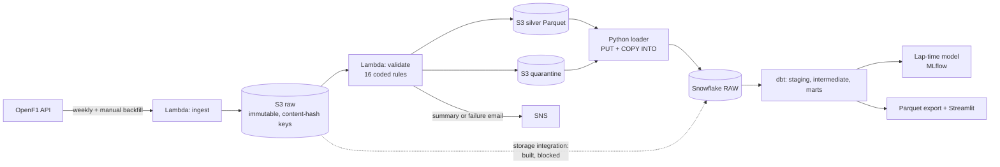

# F1 Pitwall Platform

A data platform for Formula 1 race-weekend data: scheduled ingest from OpenF1, rule-based validation
with quarantine, a Snowflake warehouse, dbt-tested marts, an honestly evaluated lap-time model
tracked in MLflow, and a dashboard that answers a strategist's questions. 2024 season: 24 races and
6 sprints.

Every number below was measured in a logged run (dated 2026-11-11) and is reproducible from this
repository. Where something is an assumption, an estimate or blocked, it says so.

## The questions and the answers

| Question | Answer from this season's data | How far to trust it |
|---|---|---|
| 1. How fast does each compound degrade, after correcting for fuel burn? | Median within-stint slope with an assumed 0.04 s/lap fuel effect: HARD +0.032 s/lap (23 races), MEDIUM +0.053 (28), SOFT +0.064 (16, small samples). Without the fuel correction: HARD -0.008, MEDIUM +0.013, SOFT +0.024. | **Weak.** The corrected slope is the uncorrected one plus the assumption. The lap-time model estimates tyre age and race progress jointly: the race-progress effect is -0.038 s/lap (95% CI -0.052 to -0.027), close to the assumed 0.04, but the MEDIUM and HARD tyre-age intervals include zero. |
| 2. What does a pit stop cost, normally and under Safety Car / VSC? | Median pit loss (in-lap + out-lap minus two reference laps): green 23.2 s (619 stops), Safety Car 10.7 s (108 stops, 6 races), VSC 14.9 s (24 stops, 6 races). | Green is solid. SC and VSC rest on few races and their per-race medians scatter widely. An estimate, not a measurement of stationary time (`stop_duration` exists only for the last races of the season). |
| 3. How often does an undercut work? | **Not answered.** Deferred; it needs position data and the hardest mart. | n/a |
| 4. Can a model forecast later clean laps better than simple baselines? | Mean absolute error across 23 held-out races: persistence 1.498 s, linear physics baseline 1.066 s, LightGBM 1.008 s. LightGBM vs the linear baseline: -0.058 s, 95% interval -0.166 to +0.043, **no detectable difference**. | Fixed settings, no tuning, one season. The model is not shown to beat the simple physics baseline. Full results: [docs/ML-RESULTS.md](docs/ML-RESULTS.md). |

The [live dashboard](https://f1-pitwall-platform-msvnskb3jcqzt2qdrsyxs2.streamlit.app/) (source: `dashboard/app.py`) shows these with their caveats beside them.

## Architecture



AWS side is one SAM template (`infra/template.yaml`). CI runs lint, tests, an offline `sam validate`
and `dbt build` on a committed DuckDB fixture, so the repository stays verifiable after the
Snowflake trial ends.

## Data quality

Bad data is detected, coded, counted and quarantined, never dropped silently. There are 16 rules
(reject, flag or warn), each with a hand-labelled good and bad golden test. Over the 30 sessions:
laps 29,052 raw = 29,034 silver + 18 quarantined; stints 1,469 = 1,453 + 16; every session
reconciles. The same counts are checked again after loading into Snowflake. Per-rule counts and
review notes are in [docs/DQ-CATALOGUE.md](docs/DQ-CATALOGUE.md), generated from the run.
Things the real data taught us (and the tests alone did not): the pit endpoint's `stop_duration` is
mostly empty, stint boundaries are inconsistent between races (aligned per race in dbt, ADR 0012),
and Safety Car and VSC share one category and must be told apart from message text.

## Measured cost and performance (2026-11-11)

| Item | Measured |
|---|---|
| AWS actual spend so far | 0.00 USD on the budget tracker (limit 5.00) and 0.00 USD for the current month on the Billing page, which also showed 140.00 USD of credits remaining (100 USD sign-up credit plus 40 USD earned from activities). The "no cost data available" note and possible reporting lag mean this shows no charges, not a to-the-cent account of usage. |
| Snowflake credits | 0.23 of the 10-credit monthly cap (trial account), across loads, dbt builds and exports |
| First 2024 backfill (Lambda) | 583 s, 101 MB; a repeat run that changes nothing: 2.1 s and 3.5 s |
| Validator (Lambda) | 16.7 to 19.0 s for 30 sessions, 173 MB |
| Stored in S3 | 452 objects, 17.4 MB |
| Snowflake `dbt build` | about 35 s (63 checks) |
| Tests | 80 Python tests; 63 dbt checks (46 data tests); CI green |
| Teardown and rebuild | Deleted the whole AWS stack, redeployed from the repo and re-ran the backfill: 452 of 452 object keys identical, 210 Parquet files byte-identical, row counts match Snowflake. The first `sam deploy` failed silently once (cause unknown); the retry succeeded. |

## Limits and things that did not work

- **GitHub OIDC deploy is blocked.** An AWS service control policy in this account's organization
  explicitly denies creating an OIDC provider (ADR 0014), so CI has no AWS access and deploys are
  run by hand with short-lived credentials.
- **The Snowflake storage integration was built but never worked.** Snowflake could not assume its
  AWS role and the cause was not established; data is loaded through an internal stage instead
  (ADR 0011).
- One season; every circuit appears once. The fuel effect is partly an assumption. Pit loss is an
  estimate. Track status comes from message timestamps and edge laps are approximate.
- An earlier, separate Monza simulator estimated Monza pit loss at 21.2 s (lane time minus an
  assumed 3.5 s); this project's empirical estimate for Monza under green flags is 26.8 s. The two
  methods disagree and neither is validated.
- The lap-time model covers dry running only: it uses 23 of the 24 races because Interlagos (wet) is
  excluded entirely, and Montreal, Silverstone and Catalunya lose their rain-affected laps.
- The reasoning behind each choice, including the ones that did not work out, is in [docs/adr/](docs/adr/).

## Run it

```powershell
python -m venv .venv; .\.venv\Scripts\python.exe -m pip install -r requirements.txt
.\.venv\Scripts\ruff.exe check . ; .\.venv\Scripts\pytest.exe -q
cd dbt; ..\.venv\Scripts\dbt.exe deps --profiles-dir . ; ..\.venv\Scripts\dbt.exe build --profiles-dir . --target duckdb
.\.venv\Scripts\streamlit.exe run dashboard\app.py
```

The Snowflake, AWS and model-training steps need your own accounts and credentials (never stored in
this repo): see `warehouse/`, `infra/`, `scripts/teardown.ps1` (dry run by default) and
`python -m ml.run`.

## Decisions

Architecture decisions are recorded in [docs/adr/](docs/adr/) (ADR 0001 to 0014); the plan is in
[docs/PLAN.md](docs/PLAN.md).

## Data source and attribution

Timing data comes from the unofficial [OpenF1](https://openf1.org) API. F1, FORMULA ONE and related
marks are trademarks of Formula One Licensing B.V.; this project is not affiliated with them. OpenF1's
terms for reusing the data have not been verified, so row-level data is not committed (only small
fixtures and aggregated tables).
