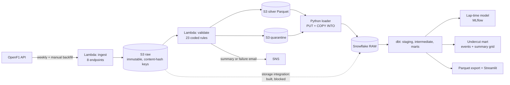

# F1 Pitwall Platform

A data platform for Formula 1 race-weekend data: scheduled ingest from OpenF1, rule-based validation
with quarantine, a Snowflake warehouse, dbt-tested marts, an honestly evaluated lap-time model
tracked in MLflow, and a dashboard that answers a strategist's questions. 2023 to 2025: 88 sessions
(70 races and 18 sprints).

Every number below was measured in a logged run (dated 2026-11-11) and is reproducible from this
repository. Where something is an assumption, an estimate or blocked, it says so.

## The questions and the answers

| Question | Answer from the 2023 to 2025 data | How far to trust it |
|---|---|---|
| 1. How fast does each compound degrade, after correcting for fuel burn? | Median within-stint slope with an assumed 0.04 s/lap fuel effect: SOFT +0.053 s/lap (50 race fits), MEDIUM +0.045 (79), HARD +0.028 (65). Without the fuel correction: +0.013, +0.005, -0.012. | **Weak.** The corrected slope is the uncorrected one plus the assumption. The lap-time model estimates tyre age and race progress jointly: the race-progress effect is -0.040 s/lap (95% CI -0.047 to -0.035), close to the assumed 0.04; the SOFT and HARD tyre-age intervals exclude zero, the MEDIUM one (-0.011 to +0.050) does not. Per-season figures: [docs/SEASON-RESULTS.md](docs/SEASON-RESULTS.md). |
| 2. What does a pit stop cost, normally and under Safety Car / VSC? | Green flag: median pit loss (in-lap + out-lap minus two reference laps) 23.1 s over 1,616 stops in 68 races, steady between seasons (22.9 to 23.2 s). Under Safety Car and VSC the estimate is **not stable**: SC 10.7 s (2024), 4.2 s (2025), -3.9 s (2023); VSC 14.9 s, 10.4 s, 32.2 s. Stationary time exists for 721 of 842 ordinary stops in 2025 (median of race medians 2.70 s) and for almost none before. | Green is solid. A negative SC value, or a VSC value above green, shows the estimator breaks down under neutralisation, so SC and VSC figures are rough at best and pooled numbers should not be quoted without the per-season ones. |
| 3. How often does an undercut work? | **44.8% of 163 decided attempts** (73 successes, 90 failures; 164 attempts in 49 races) under a stated definition: car A stops with car B directly ahead and a known gap of at most 3 s, B stops within 3 laps, no neutralised lap, success if A is ahead two laps after B's stop. 95% interval over races 35.2% to 53.4%. | **The headline is one point on a curve.** With a 3-lap window the rate runs from 73% (gap up to 1 s, n=48) to 28% (up to 10 s, n=298). Pace difference between the cars, tyres and traffic are not controlled. The definition was frozen before any outcome was computed ([ADR 0016](docs/adr/0016-undercut-definition.md)); full tables in [docs/UNDERCUT-RESULTS.md](docs/UNDERCUT-RESULTS.md). |
| 4. Can a model forecast later clean laps better than simple baselines? | Mean absolute error across 66 held-out races (54,082 laps): persistence 1.624 s, linear physics baseline 1.085 s, LightGBM 0.935 s. LightGBM vs the linear baseline: -0.150 s, 95% interval -0.265 to -0.047, better in 47 of 66 races. | Fixed settings, no tuning. With the first season alone (23 races) there was **no detectable difference**; the wider data changed that. Holding out a whole season gives the same direction (LightGBM minus linear -0.026, -0.018 and -0.130 s for 2023, 2024, 2025), but the first two margins are small. Persistence still beats the linear baseline at Spielberg and Imola (2024 and 2025). Full results: [docs/ML-RESULTS.md](docs/ML-RESULTS.md). |

The [live dashboard](https://f1-pitwall-platform-msvnskb3jcqzt2qdrsyxs2.streamlit.app/) (source: `dashboard/app.py`) shows these with their caveats beside them.

## Architecture



AWS side is one SAM template (`infra/template.yaml`). CI runs lint, tests, an offline `sam validate`
and `dbt build` (including unit tests) on a committed DuckDB fixture, so the repository stays
verifiable after the Snowflake trial ends. A full season takes close to the Lambda's 900 s limit, so
the ingest stops starting new sessions when under 90 s remain and is simply run again.

## Data quality

Bad data is detected, coded, counted and quarantined, never dropped silently. There are 23 rules
(reject, flag or warn), each with a hand-labelled good and bad golden test. Over the 88 sessions:
laps 84,140 raw = 84,122 silver + 18 quarantined; stints 4,472 = 4,433 + 39; position events
37,778 and interval rows 1,812,781 all kept; every session reconciles, in S3 and again after loading
into Snowflake (a repeat load staged and loaded 0 files). Per-rule counts and review notes are in
[docs/DQ-CATALOGUE.md](docs/DQ-CATALOGUE.md), generated from the run.
Things the real data taught us (and the tests alone did not): the pit endpoint's `stop_duration` is
empty before the 2024 US Grand Prix; stint boundaries are inconsistent between races (aligned per
race in dbt, ADR 0012) and in five 2025 sessions the stints disagree with the pit stops altogether (four of
them are left out of the tyre figures, ADR 0017); Safety Car and VSC share one category and must be
told apart from message text; a first position rule that flagged every short-lived duplicate fired on
166 rows and had to be recalibrated (ADR 0015); and `intervals` contradicts itself (gap to leader
below gap to the car ahead) on 1,297 rows, most of them in two 2024 races.

## Measured cost and performance (2026-11-11)

| Item | Measured |
|---|---|
| AWS actual spend | 0.00 USD on the budget tracker (limit 5.00). An earlier Billing-page reading showed 0.00 USD for the month and 140.00 USD of credits remaining (100 USD sign-up credit plus 40 USD earned); credits were not re-read since. "No cost data" and reporting lag mean this shows no charges, not a to-the-cent account of usage. |
| Snowflake credits | 0.63 of the 10-credit monthly cap (trial account), across all loads, dbt builds and exports |
| Lambda backfill | One season, eight endpoints: 853 s (2023), 866 s plus 40 s (2025, stopped early by design and run again). Repeat runs that change nothing: 5 to 6 s |
| Validator (Lambda) | 40.9 s and 213 MB for one season; 118 s for three seasons in one call |
| Stored in S3 | 1,678 objects, 328.7 MB (raw `intervals` is 255 MB, 78%) |
| Snowflake load | 522 files staged and loaded in 212 s; a repeat load loads 0 files |
| Snowflake `dbt build` | about 90 to 110 s (97 checks) |
| Tests | 112 Python tests; 97 dbt checks (64 data tests, 8 unit tests); CI green |
| Teardown and rebuild | Earlier rehearsal: deleted the whole AWS stack, redeployed from the repo and re-ran the backfill: all object keys identical, Parquet byte-identical, row counts match Snowflake. The first `sam deploy` failed silently once (cause unknown). Since then the stack was only updated in place; the teardown script's dry run lists the same 11 resources |

## Limits and things that did not work

- **GitHub OIDC deploy is blocked.** An AWS service control policy in this account's organization
  explicitly denies creating an OIDC provider (ADR 0014), so CI has no AWS access and deploys are
  run by hand with short-lived credentials.
- **The Snowflake storage integration was built but never worked.** Snowflake could not assume its
  AWS role and the cause was not established; data is loaded through an internal stage instead
  (ADR 0011). A look at CloudTrail found no trace of the failed attempts (ADR 0019).
- Three seasons; nothing here is a claim about other years or regulations. Circuits repeat across
  seasons, which flatters leave-one-race-out (the season-out check is the stricter one). The fuel
  effect is partly an assumption. Pit loss is an estimate and unreliable under neutralisation. Track
  status comes from message timestamps and edge laps are approximate.
- The undercut figure is a frequency under one definition on a small sample, without control for car
  pace; position is the on-track order from the position stream, not the official classification.
- OpenF1 documents `pit_duration` and `drivers.country_code` as removed after the 2026 season; both are
  optional in the schema check, and 2026 sessions are not ingested.
- An earlier, separate Monza simulator estimated Monza pit loss at 21.2 s (lane time minus an assumed
  3.5 s); this project's empirical estimate for Monza under green flags is 25.5 s (2023), 26.8 s (2024)
  and 24.6 s (2025). The methods differ and neither is validated. Swapping the empirical value into the
  simulator moves its single-stop win probability from 53.77% to about 50%, i.e. a coin flip.
- The lap-time model covers dry running only: it uses 66 of the 70 races (Interlagos 2024 is wet; the 2025
  Miami, Monaco and Spa sessions are excluded by the stint check).
- The Snowflake loader skips a file whose name it has already loaded, so a changed file of the same
  name is not replaced unless you run it with `--full-refresh`; `reconcile` detects a stale load.
- The reasoning behind each choice, including the ones that did not work out, is in [docs/adr/](docs/adr/).

## Run it

```powershell
python -m venv .venv; .\.venv\Scripts\python.exe -m pip install -r requirements.txt
.\.venv\Scripts\ruff.exe check . ; .\.venv\Scripts\pytest.exe -q
cd dbt; ..\.venv\Scripts\dbt.exe deps --profiles-dir . ; ..\.venv\Scripts\dbt.exe build --profiles-dir . --target duckdb
.\.venv\Scripts\streamlit.exe run dashboard\app.py
```

The Snowflake, AWS and model-training steps need your own accounts and credentials (never stored in
this repo): see `warehouse/`, `infra/`, `scripts/teardown.ps1` (dry run by default),
`python -m ml.run`, `python -m ml.season_report` and `python -m undercut.report`.

## Decisions

Architecture decisions are recorded in [docs/adr/](docs/adr/) (ADR 0001 to 0019); the plan is in
[docs/PLAN.md](docs/PLAN.md).

## Data source and attribution

Timing data comes from the unofficial [OpenF1](https://openf1.org) API. F1, FORMULA ONE and related
marks are trademarks of Formula One Licensing B.V.; this project is not affiliated with them. OpenF1
states no terms for reusing its data, and its source repository carries a Creative Commons
Attribution-NonCommercial-ShareAlike 4.0 licence file whose scope over the data is not stated. This
project is non-commercial, commits no full row-level data (only aggregated tables and a small CI
fixture, partly synthetic) and keeps this notice; see [ADR 0018](docs/adr/0018-openf1-data-reuse.md).
